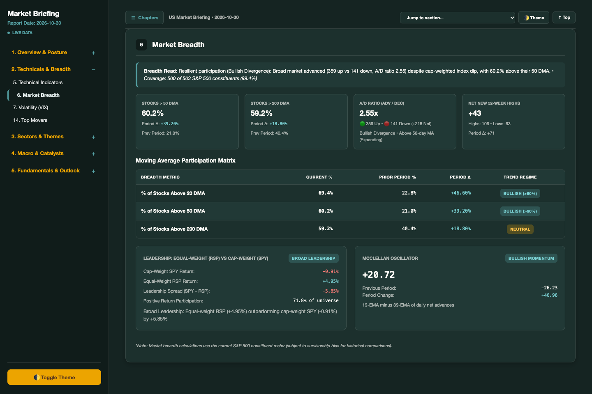
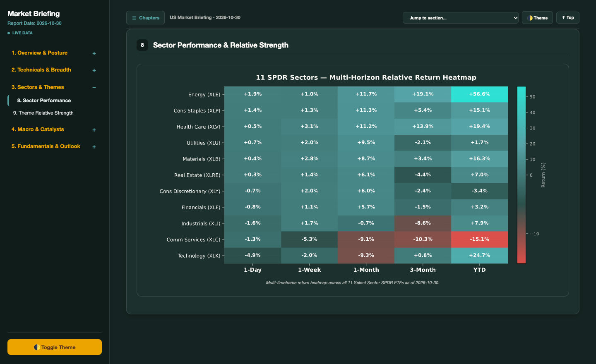

# Automated US Market Report Generator

A clean, modular Python quantitative platform engineered to generate automated **Daily**, **Weekly**, and **Monthly** US market reports in both GitHub-flavored **Markdown** and standalone, responsive **HTML** with light/dark mode support, publication-grade visual charts, automated scheduling, and MIME email delivery.

---

## ⚡ 10-Second Quickstart

Clone and run the automated launcher (automatically handles virtual environment setup, dependencies, and opens the daily report in your browser):

```bash
git clone https://github.com/DavidStojcev/swing-trading-market-report.git
cd swing-trading-market-report
./run.sh      # macOS / Linux
# or run.bat on Windows
```

> **Zero API Keys Required**: The platform runs 100% out of the box using free, resilient public market feeds (`yfinance`). Optional macroeconomic and email feeds can be added at any time.

---

## 🌐 Zero-Install Daily Web Dashboard (GitHub Pages)

Don't want to run Python locally? You can fork this repository to get your own free, automated daily market website:

1. Click **Fork** (top-right of this repository).
2. In your forked repo, go to **Settings** → **Pages**.
3. Under **Build and deployment**, set **Source** to **GitHub Actions**.
4. Every weekday at US market close (21:00 UTC), GitHub Actions will automatically generate the report and publish it live to:
   ```text
   https://<your-username>.github.io/market-report/
   ```
5. Bookmark that URL on your phone or desktop for a fresh, interactive report every afternoon!
   *(You can also trigger a fresh report on-demand anytime from the **Actions** tab → **Run workflow**).*

---

## 📊 Report Showcase & Visual Preview

Each generated report is fully standalone (works offline with embedded vector graphics), supports responsive light/dark themes, and delivers institutional-grade quantitative market analytics.

### Market Breadth & Internal Participation
Vectorized S&P 500 constituent breadth tracking % of stocks above key moving averages (20/50/200 DMA), Advance/Decline ratios, Net 52-week Highs, Cap-Weight vs. Equal-Weight leadership spread (`SPY` vs. `RSP`), and the McClellan Oscillator:



### Sector Multi-Horizon Relative Return Heatmap
All 11 Select Sector SPDR ETFs tracked dynamically across multiple time horizons (1-Day, 1-Week, 1-Month, 3-Month, and YTD) to identify capital rotation, momentum leadership, and tactical divergence:



Generated reports are automatically saved to:
- `reports/daily/YYYY-MM-DD.html`, `.md`, `.eml`
- `reports/weekly/YYYY-MM-DD.html`, `.md`, `.eml`
- `reports/monthly/YYYY-MM-DD.html`, `.md`, `.eml`

---

## 💻 CLI Usage

### Everyday Commands

```bash
# 1. Interactive Wizard (press Enter to run today's report and auto-open HTML)
python report.py

# 2. Daily Report (generate and open immediately in default browser)
python report.py -O

# 3. Weekly Report (Week-to-date vs. prior completed week)
python report.py -t weekly -O

# 4. Monthly Report (Month-to-date vs. prior completed month)
python report.py -t monthly -O

# 5. Historical Analysis (generate report for any past trading date)
python report.py -t daily -d 2026-10-15 -O

# 6. Analyze a Custom Stock Watchlist on the fly
python report.py --tickers NVDA,AAPL,TSLA,PLTR -O

# 7. Point to a Custom Watchlist CSV
python report.py -w watchlist.csv -O
```

### Advanced Automation Flags

| Flag | Description | Example |
| :--- | :--- | :--- |
| `-t, --type` | Select report frequency (`daily`, `weekly`, `monthly`) | `-t weekly` |
| `-d, --date` | Target date in `YYYY-MM-DD` format | `-d 2026-10-15` |
| `-O, --open` | Automatically open the generated HTML report in browser | `-O` |
| `-q, --quiet` | Suppress log messages, clean terminal progress only | `-q` |
| `--email` | Send report via SMTP to configured email recipients | `--email` |
| `--dry-run-email` | Create local `.eml` file with inline charts without sending | `--dry-run-email` |
| `--no-cache` | Force fresh download of market data, bypassing cache | `--no-cache` |
| `--if-scheduled-day`| Runs only if today is the scheduled report day (skips weekends/holidays) | `--if-scheduled-day` |

---

## ⚙️ Configuration & Customization

### 1. Optional API Keys & Email Delivery (`.env`)

To enable automated email delivery or macroeconomic data feeds (FRED, Finnhub):

```bash
cp .env.example .env
```

Open `.env` and fill in any settings you want to use:

```env
# Optional Macro Providers (falls back gracefully if omitted)
FRED_API_KEY=your_fred_api_key_here
FINNHUB_API_KEY=your_finnhub_api_key_here

# Optional Email Delivery (SMTP)
SMTP_HOST=smtp.gmail.com
SMTP_PORT=587
SMTP_USER=your_email@gmail.com
SMTP_PASSWORD=your_app_password
EMAIL_FROM=Market Report <your_email@gmail.com>
EMAIL_TO=recipient@example.com
```

### 2. Strategy & Scoring Customization (`config/config.yaml`)

You can customize weights, technical thresholds, chart dimensions, and universe filters directly in [`config/config.yaml`](config/config.yaml):
- **Indicator Weights**: Adjust the voting weights of Technical, Macro, and Breadth categories.
- **RSI / MACD / ADX Thresholds**: Modify overbought/oversold boundaries.
- **Filter Criteria**: Adjust minimum price (`≥ $5`), liquidity (`≥ 1M shares/day`), or market cap thresholds.

---

## 🧠 Trend Scoring Engine

The scoring engine evaluates indicator states, applies weighted votes, and normalizes them into a $[-1.0, +1.0]$ consensus score:

### 1. Technical Indicators (Weight 1.0)
- **Price vs. 50 DMA**: Price > 50 DMA ⇒ `+1`; below ⇒ `-1`
- **Price vs. 200 DMA**: Price > 200 DMA ⇒ `+1`; below ⇒ `-1`
- **50 DMA vs. 200 DMA**: 50 DMA > 200 DMA ⇒ `+1`; below ⇒ `-1`
- **MACD vs. Signal**: MACD Line > Signal Line ⇒ `+1`; below ⇒ `-1`
- **VIX Regime**: VIX < 20 and falling ⇒ `+1`; VIX > 25 and rising ⇒ `-1`; neutral ⇒ `0`
- **RSI(14)**: Caution flag if > 70 (Overbought) or < 30 (Oversold). *(Non-voting)*

### 2. Macroeconomic Indicators (Weight 0.5, Toggleable)
- **10Y Yield Shift**: 10Y yield surging (> 15 bps) ⇒ `-1`; falling sharply ⇒ `+1`
- **2s10s Yield Curve**: Inverted (10Y − 2Y < 0) ⇒ `-1`; normal (> 0) ⇒ `+1`
- **Dollar Index (DXY)**: Sharp rise (> 1.0% over period) ⇒ `-1`
- **Inflation Surprise**: Hotter than forecast ⇒ `-1`; cooler ⇒ `+1`
- **Labor Surprise**: Strong jobs + inflation not hot ⇒ `+1`

### 3. Market Breadth Indicators (Weight 0.5, Toggleable)
- **Stocks Above 50 DMA**: > 60% ⇒ `+1`; < 40% ⇒ `-1`
- **Stocks Above 200 DMA**: > 60% ⇒ `+1`; < 40% ⇒ `-1`
- **Net New 52W Highs**: Positive and expanding ⇒ `+1`; strongly negative (≤ -10) ⇒ `-1`
- **Equal-Weight Spread**: Cap-weight SPY beating RSP by > 1.0% ⇒ `-1` (Narrow Leadership); broad leadership ⇒ `+1`
- **A/D Line Confirmation**: A/D line confirms index move ⇒ `+1`; diverging from index ⇒ `-1`

### Verdict Thresholds
- 🟢 **Bullish**: Normalized Score ≥ `+0.30`
- ⚪ **Neutral**: `-0.30` < Score < `+0.30`
- 🔴 **Bearish**: Normalized Score ≤ `-0.30`

---

## ⏰ Automated Scheduling

### 1. Crontab (Local / Server)
Run automatically on trading days after the NYSE close (~4:30 PM ET):

```cron
# Daily report at 16:30 ET Mon-Fri (checks if active session)
30 16 * * 1-5 cd "/path/to/Market Report" && .venv/bin/python report.py -t daily --if-scheduled-day --email

# Weekly report at 17:00 ET Mon-Fri (runs only on week's final trading day)
00 17 * * 1-5 cd "/path/to/Market Report" && .venv/bin/python report.py -t weekly --if-scheduled-day --email

# Monthly report at 17:30 ET Mon-Fri (runs only on month's final trading day)
30 17 * * 1-5 cd "/path/to/Market Report" && .venv/bin/python report.py -t monthly --if-scheduled-day --email
```

### 2. GitHub Actions Workflow
The repository includes an automated workflow at [`.github/workflows/market_report.yml`](.github/workflows/market_report.yml):
- **Schedule**: Automatically runs at `21:00 UTC` Monday–Friday.
- **DST & Calendar Intelligence**: Uses `exchange_calendars` to handle daylight saving shifts, market holidays (Good Friday, Thanksgiving, Christmas), and early closes cleanly.
- **Data Caching**: Caches `.cache/` and `logs/` to minimize data transfer across runs.
- **Artifacts & Publishing**: Automatically publishes the HTML report to GitHub Pages and stores 30-day report artifacts.

---

## 🛠️ Manual Installation (For Developers)

```bash
# 1. Clone repository
git clone https://github.com/DavidStojcev/swing-trading-market-report.git
cd swing-trading-market-report

# 2. Set up virtual environment
python3 -m venv .venv
source .venv/bin/activate

# 3. Install dependencies
pip install -r requirements.txt
pip install -e .

# Or using uv (recommended for ultra-fast installs):
uv venv .venv
source .venv/bin/activate
uv pip install -e .
```

---

## 🏗️ Architecture & Directory Layout

```text
market_report/
├── .github/
│   └── workflows/
│       └── market_report.yml # Automated GitHub Actions cron & Pages deployment
├── config/
│   ├── config.yaml          # Indicator weights, scoring thresholds, charts, email settings
│   └── settings.py         # Strongly-typed configuration loader
├── data/
│   ├── base.py             # Abstract DataProvider interface
│   ├── yfinance_provider.py# Resilient YFinance provider (caching, chunking, backoff)
│   ├── constituents.py     # S&P 500 + Nasdaq-100 universe scraper & local cache
│   ├── cache.py            # Local Parquet OHLCV caching engine
│   ├── calendar.py         # NYSE/NASDAQ calendar (America/New_York, holidays)
│   ├── macro_base.py       # Abstract EconCalendarProvider interface
│   ├── fred_provider.py    # FRED API client with local JSON caching
│   ├── calendar_provider.py# Finnhub economic & earnings calendar provider
│   └── fomc.py             # FOMC rate target tracking and meeting schedule calendar
├── delivery/
│   └── email_sender.py     # SMTP TLS delivery, inline CID charts, and .eml export
├── indicators/
│   ├── moving_averages.py  # 20/50/200 DMA & Golden/Death cross detection
│   ├── momentum.py         # RSI(14) using Wilder's smoothing
│   ├── trend.py            # MACD(12,26,9) & ADX(14) with +DI/-DI
│   ├── breadth.py          # S&P 500 breadth (% above MAs, A/D, 52W H/L, RSP vs SPY)
│   └── engine.py           # Unified technical computation pipeline
├── scoring/
│   ├── rules.py            # Technical, macro, and breadth voting rules (+1 / 0 / -1)
│   └── engine.py           # Trend scoring, weight normalization, explainable verdict
├── sections/
│   ├── executive_summary.py# Verdict, score, and 3-5 line core posture
│   ├── index_snapshot.py   # Major benchmark table & 20-day volume deltas
│   ├── technicals.py       # SPX & NDX DMA/Cross/RSI/MACD/ADX tables
│   ├── volatility.py       # VIX level, regime classification, and daily implied move
│   ├── macro.py            # Economic releases, Fed policy, yields, cross-asset snapshot
│   ├── sectors.py          # 11 SPDR sectors ranked by relative strength vs SPY
│   ├── breadth.py          # % above MAs, Advance/Decline, 52W Highs/Lows, RSP vs SPY
│   ├── movers.py           # Top 5 gainers / losers (Day, Week, Month)
│   └── conclusion.py       # Transparent voting scorecard & key support/resistance levels
├── storage/
│   └── snapshots.py        # SQLite state store for period-over-period delta comparisons
├── render/
│   ├── charts.py           # Matplotlib chart generator (dark/light themes, transparent PNG)
│   ├── markdown.py         # Clean Markdown report formatter
│   └── html.py             # Standalone HTML report with embedded CSS & inline charts
├── reports/                # Generated reports saved to /reports/{daily|weekly|monthly}/
├── tests/                  # Unit test suite covering all indicators, calendar, and rendering
├── report.py               # Main CLI executable and interactive wizard
├── pyproject.toml          # Package build configuration and CLI entry points
├── requirements.txt        # Pinned project dependencies
└── run.sh / run.bat        # Automated one-click quickstart launchers
```

---

## 🧪 Unit Testing

Run the comprehensive test suite with `pytest`:

```bash
pytest -v
```

The test suite covers:
- **Trading Calendar**: NYSE/NASDAQ calendar, holiday checks, weekend detection, scheduled day triggers.
- **Technical Indicators**: 20/50/200 DMA, Golden/Death crosses, Wilder's smoothed RSI(14), MACD(12,26,9), ADX(14).
- **Macro & Rates**: Inflation MoM/YoY calculations, Nonfarm Payroll surprises, Real GDP QoQ, yield spread inversion.
- **Market Breadth**: % above MAs, Advance/Decline counts, McClellan Oscillator, Net 52-week Highs/Lows.
- **Charts & Reports**: Headless Matplotlib chart rendering, HTML generation, and MIME email builder.

---

## 📜 License

This project is licensed under the [MIT License](LICENSE).

---

## ⚖️ Legal & Financial Disclaimer

> [!IMPORTANT]
> **NOT FINANCIAL ADVICE. FOR EDUCATIONAL AND INFORMATIONAL PURPOSES ONLY.**
> 
> * **No Investment Advice**: This software and its generated reports are designed purely for informational, research, and educational purposes. Nothing contained herein constitutes investment, financial, trading, accounting, or legal advice, nor does it constitute a recommendation, endorsement, or solicitation to buy, sell, hold, or trade any security, derivative, commodity, or financial instrument.
> * **No Warranty & Limitation of Liability**: The software is provided "as is", without warranty of any kind, express or implied. Under no circumstances shall the authors, contributors, or copyright holders be held liable for any direct, indirect, incidental, consequential, special, or exemplary damages, or any financial losses, lost profits, or business interruption.
> * **Risk of Trading**: Trading in equities, options, futures, and other financial instruments involves substantial risk of loss and is not suitable for every investor. Users must conduct their own independent due diligence and consult with a licensed professional financial adviser before making any investment decisions.
> * **Third-Party Data & Trademarks**: Market data is retrieved via third-party providers (`yfinance`, FRED, Finnhub). Users are solely responsible for obtaining their own API keys and complying with the respective providers' Terms of Service. All product names, logos, index names (e.g., S&P 500®, Nasdaq-100®, Russell 2000®, Cboe VIX®), and trademarks belong to their respective owners.
